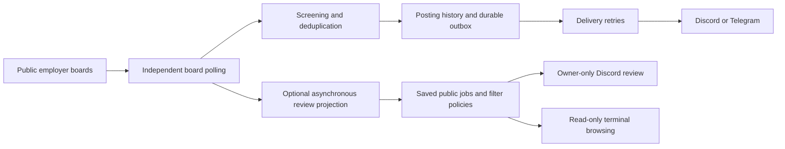

# Architecture

The monitor favors durable state and a short delivery path for a single user.
There is no hosted database, message broker or model service.

## Components

| Module | Responsibility |
| --- | --- |
| `sources` | Provider adapters and bounded publication metadata enrichment. |
| `screening` | Eligibility rules, rejection reasons and original-date semantics. |
| `monitor` | CLI, scan processing, state persistence and delivery acknowledgement. |
| `watch` | Board scheduling and delivery retries using separate executors. |
| `notifications` | Bounded messages and provider-specific delivery handling. |
| `health` | Worker, source and delivery health projections. |
| `review_store`, `review_runtime` | Versioned settings and asynchronous public-job storage. |
| `review_bot`, `cli_menu` | Discord interaction and terminal presentation. |
| `prioritization`, `rank_jobs`, `learning` | Experimental offline assessment and private preference storage. |

Provider adapters isolate source differences. Pure screening/evaluation logic
has no notification side effects. Storage and presentation have distinct owners;
the optional learning repository does not own posting history or hard filters.
These boundaries keep the system small while supporting independent failures.

## Reliability limits

Posting history and the outbox share atomic state saves. Each delivery is
acknowledged independently. Ambiguous remote acknowledgement can cause a retry
and duplicate message; silent loss is the less acceptable outcome. Preserve the
state file and run one worker against it.

A failed board retains last-observed state. Other boards and delivery retries
can continue. Backoff and rate limits affect latency. Original publication is
often unavailable, and employer feeds can lag the original careers page.

Optional review, feedback and future ranking must not delay alerts. The
experimental classifier, automatic retraining and alert-specific rating action
are not implemented. No claim of learned recommendation quality is made.

The editable [Excalidraw drawing](job-monitor-system-design.excalidraw) and
[SVG](job-monitor-system-design.svg) document an earlier system snapshot; the
component boundaries above describe the current source layout.
